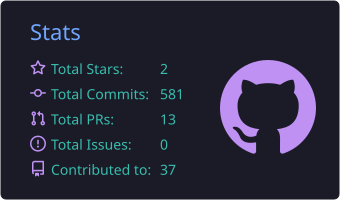
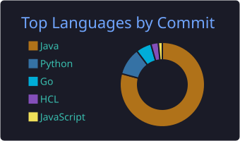
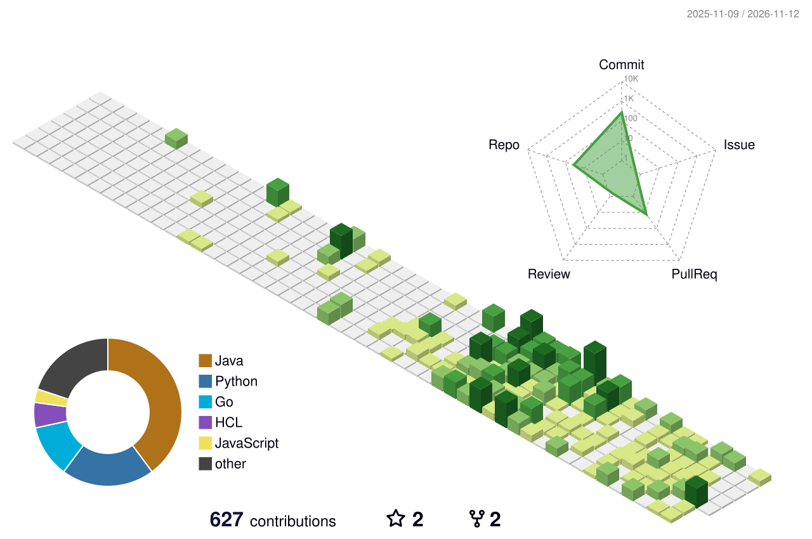

<!-- Animated typing header -->

---

### 🚀 About Me

- 🎓 Aspiring **Backend / Java Developer**, passionate about building scalable server-side systems
- 🔭 Currently deepening my expertise in **Spring Boot**, **REST APIs**, and **Microservices Architecture**
- 💼 **Actively seeking Internship Opportunities** as a **Java Developer / Backend Developer**
- 🌱 Exploring cloud-native development with **AWS**, **Docker**, and **Kubernetes**
- 💬 Ask me about Java, Spring Boot, Databases, or DevOps basics
- ⚡ Fun fact: I enjoy solving DSA problems on LeetCode as much as I enjoy debugging production code

---

### 🛠️ Tech Stack

**Languages & Frameworks**

  

**Backend Development**

  
  
  

**Cloud & DevOps**

  

**Databases & Monitoring**

  

---

### 📂 Projects

<table>
<tr>
<td width="50%" valign="top">

**🛣️ [RouteX](https://github.com/loveyadav8478-blip/Routex)**

AI-powered Traffic Intelligence Platform built with React, Spring Boot, FastAPI, PostgreSQL, Redis, WebSockets, and AWS. Provides traffic prediction, route analytics, real-time alerts, and an intelligent route assistant.

 

</td>
<td width="50%" valign="top">

**🔗 [URL Shortener](https://github.com/loveyadav8478-blip/url-shortner)**

A REST API service that shortens long URLs and redirects users, with persistence and analytics.

 

</td>
</tr>
<tr>
<td width="50%" valign="top">

**🆘 [ReliefNet](https://github.com/loveyadav8478-blip/ReliefNet)**

A platform to coordinate disaster relief and resource distribution efficiently.

 

</td>
<td width="50%" valign="top">

**☁️ [AWS Terraform IaC](https://github.com/loveyadav8478-blip/terraform-aws-infra)**

Infrastructure-as-Code setup provisioning AWS resources using Terraform.

 

</td>
</tr>
<tr>
<td width="50%" valign="top">

**💰 [Finpilot](https://github.com/loveyadav8478-blip/Finpilot-Backend)** &nbsp; 

A personal finance / fintech assistant project — currently under active development.

 

</td>
<td width="50%" valign="top">

</td>
</tr>
</table>

---

### 📊 GitHub Stats

  
  

#### 🔀 Pull Requests

<!--PR_START-->
**13** PRs &nbsp;|&nbsp; 🟣 **11** merged &nbsp;|&nbsp; 🟢 **0** open &nbsp;|&nbsp; 🔴 **2** closed

| Repository | Pull Request | Status | Updated |
|---|---|---|---|
| [higher-kinded-j/higher-kinded-j](https://github.com/higher-kinded-j/higher-kinded-j) | [#1308 refactor: read AuditLogWriter time from an injected TimeSource](https://github.com/higher-kinded-j/higher-kinded-j/pull/1308) | 🟣 Merged | 27 Oct 2026 |
| [higher-kinded-j/higher-kinded-j](https://github.com/higher-kinded-j/higher-kinded-j) | [#1205    docs: add WriterT to transformer overview and Supported Types](https://github.com/higher-kinded-j/higher-kinded-j/pull/1205) | 🟣 Merged | 22 Oct 2026 |
| [loveyadav8478-blip/Spill-Detection](https://github.com/loveyadav8478-blip/Spill-Detection) | [#15 Finalized the full pipline error.](https://github.com/loveyadav8478-blip/Spill-Detection/pull/15) | 🟣 Merged | 25 Aug 2026 |
| [loveyadav8478-blip/Spill-Detection](https://github.com/loveyadav8478-blip/Spill-Detection) | [#13 Detection module done.](https://github.com/loveyadav8478-blip/Spill-Detection/pull/13) | 🟣 Merged | 25 Aug 2026 |
| [loveyadav8478-blip/Spill-Detection](https://github.com/loveyadav8478-blip/Spill-Detection) | [#11 Fixed the ais module and updated main as well and added db. If someth…](https://github.com/loveyadav8478-blip/Spill-Detection/pull/11) | 🟣 Merged | 24 Aug 2026 |
| [loveyadav8478-blip/Spill-Detection](https://github.com/loveyadav8478-blip/Spill-Detection) | [#6 Merge kaushlendra_codes to main: Add hindcasting services and update schemas](https://github.com/loveyadav8478-blip/Spill-Detection/pull/6) | 🟣 Merged | 24 Aug 2026 |
| [loveyadav8478-blip/Spill-Detection](https://github.com/loveyadav8478-blip/Spill-Detection) | [#7 Pr 6](https://github.com/loveyadav8478-blip/Spill-Detection/pull/7) | 🟣 Merged | 24 Aug 2026 |
| [loveyadav8478-blip/Spill-Detection](https://github.com/loveyadav8478-blip/Spill-Detection) | [#3 Kaushlendra codes makes some changes in data/schema.py](https://github.com/loveyadav8478-blip/Spill-Detection/pull/3) | 🟣 Merged | 23 Aug 2026 |
| [loveyadav8478-blip/Spill-Detection](https://github.com/loveyadav8478-blip/Spill-Detection) | [#2 This PR merges the latest hindcast and forcast implementation from the kaushlendra_codes branch into main.](https://github.com/loveyadav8478-blip/Spill-Detection/pull/2) | 🟣 Merged | 23 Aug 2026 |
| [loveyadav8478-blip/Spill-Detection](https://github.com/loveyadav8478-blip/Spill-Detection) | [#1 Just basic structuring for now.](https://github.com/loveyadav8478-blip/Spill-Detection/pull/1) | 🔴 Closed | 23 Aug 2026 |
<!--PR_END-->

  

---

### 📈 Contribution Graph

  

---

### 💼 Open to Internship Opportunities

🟢 **Currently seeking Internship opportunities as a Java Developer / Backend Developer**  
Open to remote, hybrid, or on-site roles — let's connect if your team is hiring!

---

### 📫 Connect With Me

  

